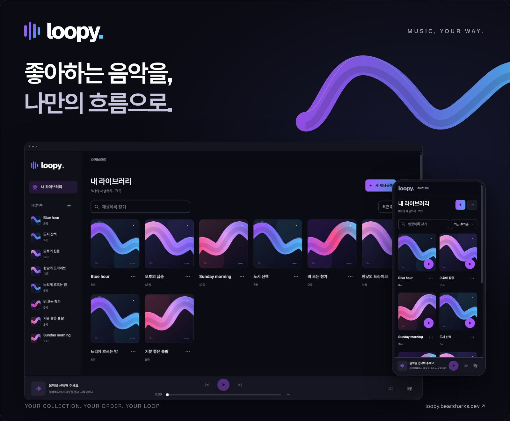
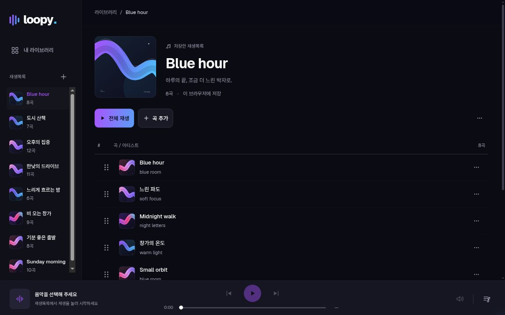

<p align="center">
  <a href="https://loopy.bearsharks.dev/">
    
  </a>
</p>

<p align="center"><sub>예시 데이터로 구성한 실제 앱 화면 · 실제 음원 재생 시연은 포함하지 않습니다.</sub></p>

<p align="center">
  좋아하는 YouTube 음악을 모으고, 내 순서로 정리하고, 오늘의 대기열로 이어 듣는 공간.<br>
  <strong>loopy는 로그인 없이 시작하는 나만의 음악 라이브러리입니다.</strong>
</p>

<p align="center">
  <a href="https://loopy.bearsharks.dev/"><strong>loopy 시작하기 ↗</strong></a>
  &nbsp; · &nbsp;
  <a href="#3단계로-첫-재생목록-만들기">사용 방법</a>
  &nbsp; · &nbsp;
  <a href="#개발하기">개발 안내</a>
</p>

<br>

## 취향은 모으고, 순서는 내 마음대로.

한 곡의 URL로 시작해도, 이미 아끼는 재생목록을 가져와도 좋습니다.<br>
이름과 설명을 붙이고 곡을 더하거나 빼고 옮기며, 나만의 목록으로 다듬어 보세요.

| 모으기 | 정리하기 | 이어 듣기 |
| :--- | :--- | :--- |
| 공개 재생목록과 영상 URL에서 시작하세요. 가능한 곡은 원래 제목도 불러옵니다. | 이름·설명·곡 순서까지. 드래그한 순서는 바로 저장됩니다. | 저장한 목록과 오늘의 대기열을 따로 편집하며 듣습니다. |

<br>

<a href="https://loopy.bearsharks.dev/">
  
</a>

<sub>화면의 재생목록·곡·아티스트는 소개를 위해 만든 예시입니다. 앱 UI는 실제 렌더이며, 히어로의 파형과 프레임은 별도로 제작한 소개용 그래픽입니다.</sub>

<br><br>

### 크게 펼쳐도, 손안에 담아도.

데스크톱에서는 라이브러리와 오른쪽 플레이어를 함께 보고, 모바일에서는 필요한 화면에 집중합니다. 하단 재생바에서 현재 곡과 대기열로 돌아갈 수 있습니다.

### 처음의 목록도, 지금의 취향도.

YouTube에서 가져온 목록은 로컬에서 자유롭게 편집할 수 있습니다. 필요할 때만 **YouTube 최신 목록 가져오기**로 갱신하거나, 최초 기록이 있는 목록을 **처음 가져온 목록으로 복원**할 수 있습니다. 자동으로 편집 내용을 덮어쓰지 않습니다.

### 내 브라우저에 저장하고, 파일로 챙겨 두세요.

목록과 곡 정보는 이 브라우저의 IndexedDB에 저장됩니다. 라이브러리 더보기에서 **목록 내보내기 / 백업 가져오기**로 보관하거나 다른 브라우저로 옮길 수 있습니다.

<br>

## 3단계로 첫 재생목록 만들기

1. **[loopy 열기](https://loopy.bearsharks.dev/)** → **새 재생목록**을 선택합니다.
2. 이름을 붙여 빈 목록을 만들거나, **유튜브에서 가져오기**에 공개 재생목록 URL을 붙여 넣습니다. URL 입력을 마치면 목록을 불러옵니다.
3. **곡 추가**로 원하는 영상을 더하고 **전체 재생**으로 듣기를 시작하세요.

<details>
<summary><strong>저장과 재생에 대해 알아두기</strong></summary>

- 계정이나 기기 간 자동 동기화는 없습니다. 사이트 데이터를 지우거나 브라우저·접속 주소를 바꾸면 기존 목록에 접근할 수 없으므로, 중요한 목록은 먼저 백업하세요.
- 음악 파일을 저장하거나 다운로드하지 않습니다. 재생은 YouTube 공식 임베드를 사용하며 인터넷 연결이 필요합니다.
- 비공개·삭제된 영상, 임베드 제한, 브라우저의 자동 재생 정책 등에 따라 가져오기나 재생이 제한될 수 있습니다.
- 제목을 가져오지 못한 곡은 임시 제목으로 저장됩니다. 목록의 **원래 곡 제목 가져오기**로 다시 시도할 수 있습니다.

</details>

<br>

## 개발하기

현재 서비스의 소스는 **[`design/shadcn-ui`](https://github.com/Bearsharks/simple-music-player/tree/design/shadcn-ui)** 브랜치에 있습니다. 기본 브랜치의 이전 앱 코드와 구분해 주세요.

**React 19 · TypeScript · Vite 8 · Jotai · IndexedDB · shadcn/ui + Radix**

Node.js 24에서 시작합니다. 기본 사용에는 별도 백엔드, 로그인, API 키 설정이 필요하지 않습니다.

```bash
git clone --branch design/shadcn-ui https://github.com/Bearsharks/simple-music-player.git
cd simple-music-player
nvm use
npm ci
npm run dev
```

개발 주소: `http://localhost:5173/simple-music-player/`

```bash
npm run check             # 기능 경계 · 타입 · 단위 테스트 · 프로덕션 빌드
npm run storybook         # 공통 UI와 상태별 컴포넌트
VITE_BASE_PATH=/ npm run build  # 루트 도메인용 빌드
```

[아키텍처](https://github.com/Bearsharks/simple-music-player/blob/design/shadcn-ui/docs/ARCHITECTURE.md) · [기능별 작업 지도](https://github.com/Bearsharks/simple-music-player/blob/design/shadcn-ui/docs/CHANGE-GUIDE.md) · [디자인 시스템](https://github.com/Bearsharks/simple-music-player/blob/design/shadcn-ui/DESIGN_SYSTEM.md)

<sub>이 저장소는 Simple Music Player에서 출발한 loopy의 소스입니다. 브라우저 모의 테스트의 성공이 모든 YouTube 영상의 실제 재생을 보장하지는 않습니다.</sub>

<br>

<p align="center"><a href="https://loopy.bearsharks.dev/"><strong>오늘의 첫 곡을 만나러 가기 ↗</strong></a></p>
