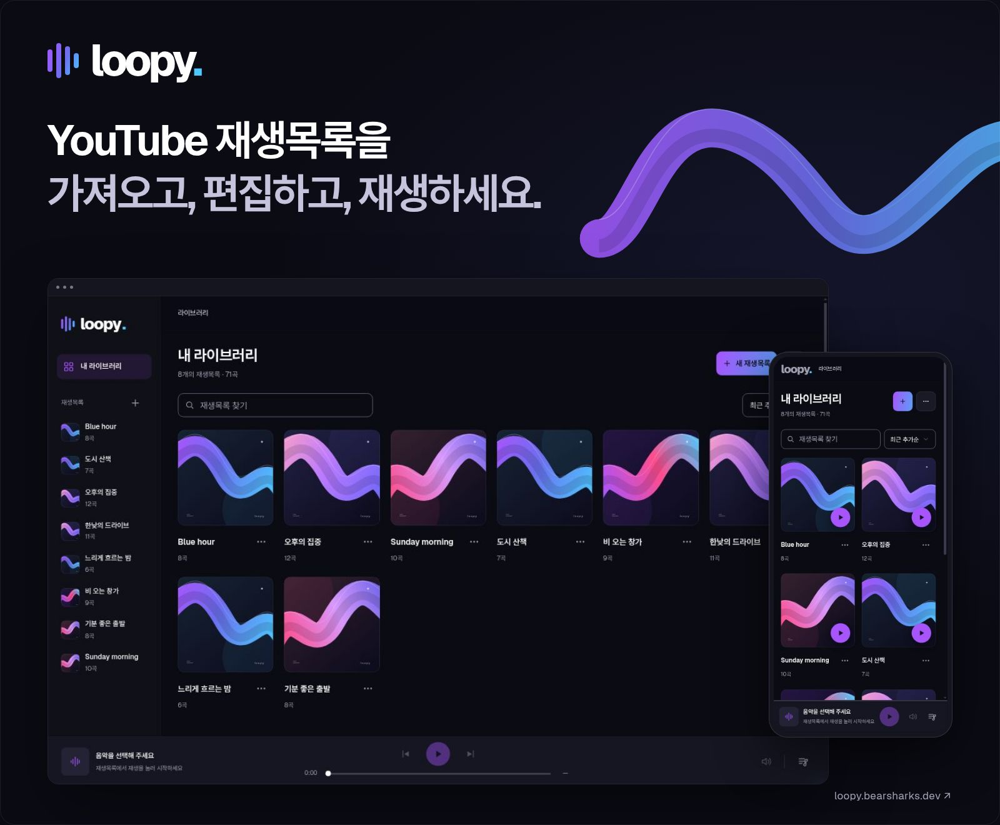

  

# loopy

YouTube의 공개 재생목록과 영상을 모아 편집하고 듣는 음악 플레이어입니다. 목록은 내 브라우저에 저장하며, 재생은 YouTube 공식 임베드를 사용합니다.

[**loopy 열기**](https://loopy.bearsharks.dev/) · [**확장 다운로드**](https://github.com/Bearsharks/loop-yt-player/releases/latest/download/loopy-extension.zip)

## 시작하기

- 앱에서 새 재생목록을 만들거나 YouTube URL을 가져옵니다.
- 확장을 사용하려면 [설치 안내](extension/README.md)를 따릅니다.
- 저장한 목록과 현재 대기열은 별도로 편집합니다. 기기 간 자동 동기화는 제공하지 않습니다.
- 가져온 결과가 원본 전체이거나 모든 영상이 재생 가능하다고 보장하지 않습니다.

## 개발 인덱스

[작업 시작](AGENTS.md) · [현재 기준](docs/canonical/README.md) · [구조](docs/canonical/architecture.md) · [기록](docs/archive/README.md)

[Node 기준](.node-version) · [실행 스크립트](package.json) · [검증 CI](.github/workflows/main.yml) · [배포 CI](.github/workflows/release.yml)
